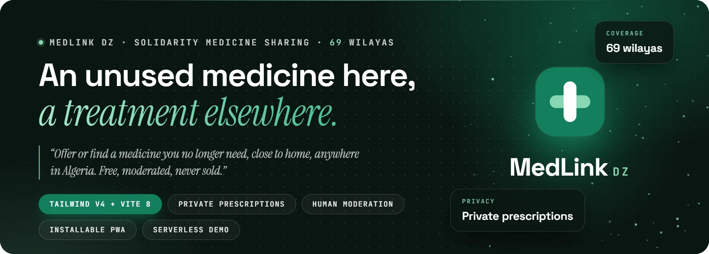
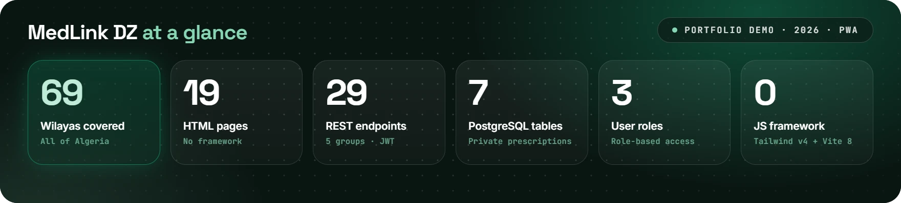
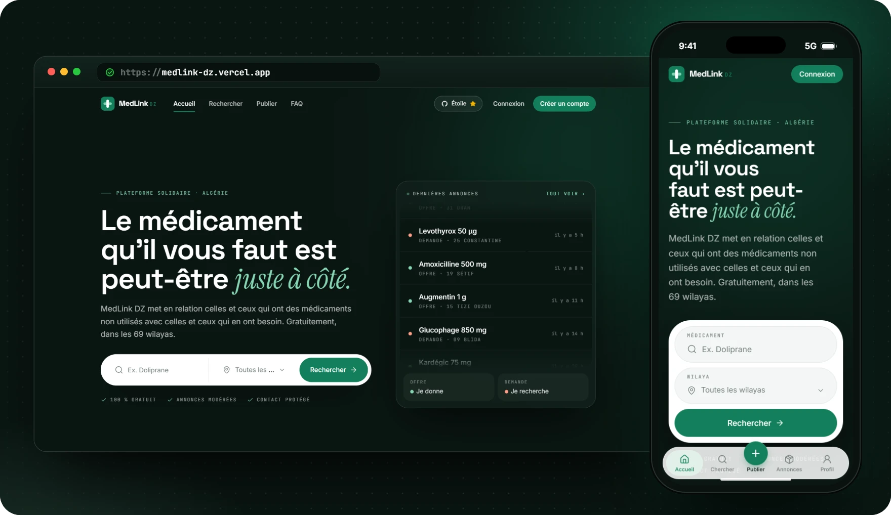
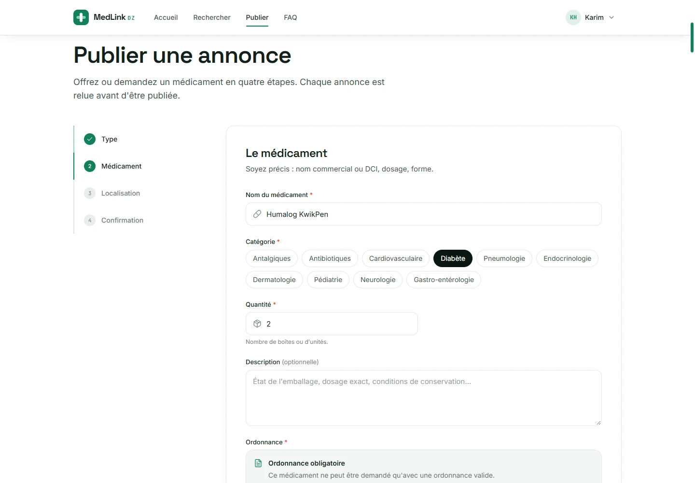
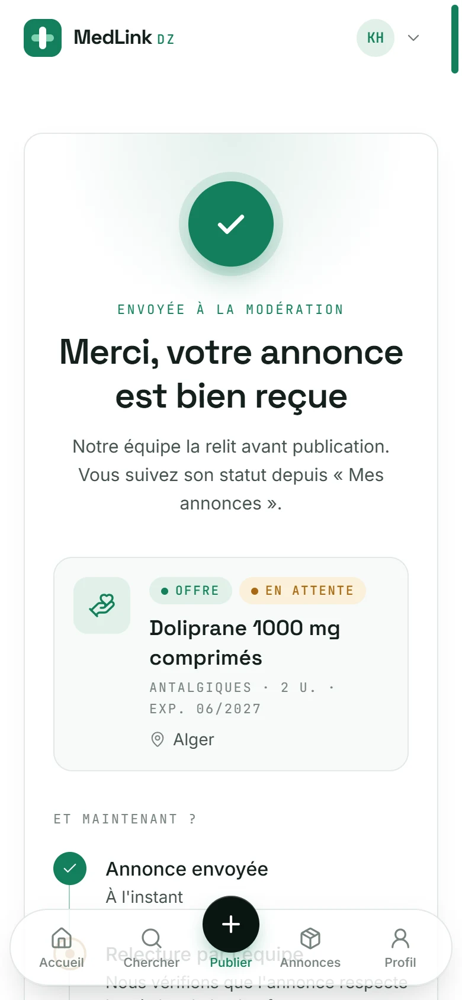
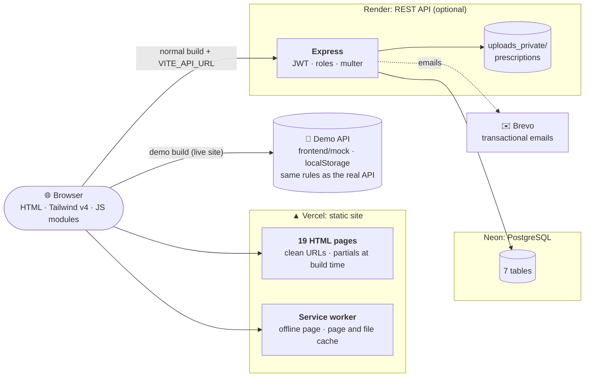
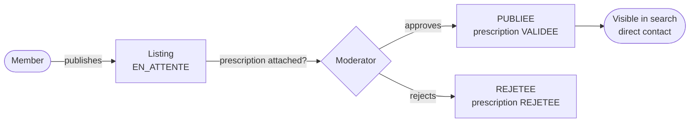

<div align="center">

<a href="https://medlink-dz.vercel.app">
  
</a>

<br><br>

# MedLink DZ

### *An unused medicine here, a treatment elsewhere. Across all 69 Algerian wilayas.*

[](https://medlink-dz.vercel.app)
[](https://github.com/islemredouane/MedLinkDZ)
[](https://tailwindcss.com)
[](https://vite.dev)
[](https://expressjs.com)
[](https://www.postgresql.org)
[](#-features)

<br>

**Full-stack portfolio project · Framework-free front end · Express + PostgreSQL API · Installable PWA**<br>
A solidarity platform where people share medicines they no longer need with people who are looking for them, with human moderation, private prescriptions and an in-browser demo that needs no server.

<br>

[**Live demo**](https://medlink-dz.vercel.app) &nbsp;✦&nbsp;
[**Screenshots**](#-screenshots--ui-tour) &nbsp;✦&nbsp;
[**Try it**](#-try-the-live-demo) &nbsp;✦&nbsp;
[**Features**](#-features) &nbsp;✦&nbsp;
[**Architecture**](#-architecture) &nbsp;✦&nbsp;
[**Security**](#-security--privacy) &nbsp;✦&nbsp;
[**Decisions**](#-technical-decisions) &nbsp;✦&nbsp;
[**Database & API**](#-database--api) &nbsp;✦&nbsp;
[**Team**](#-team--contributors)

</div>

<br>

> [!IMPORTANT]
> **This is a portfolio demo.** The live site runs entirely in your browser with fictional data: no server, no real listings, fake phone numbers (`00 00 00 00 NN`). A "Projet de démonstration" bar says so on every page, and search engines are kept out (`noindex`). The real back end (API + PostgreSQL) lives in [`backend/`](backend) and is documented in [docs/API.md](docs/API.md) and [docs/DEVELOPMENT.md](docs/DEVELOPMENT.md).



<br><br>

---

## ✦ Overview

Every year, boxes of perfectly good medicine end up in the bin while other patients go from pharmacy to pharmacy looking for the same treatment. **MedLink DZ** connects the two sides: a member **offers** a medicine they no longer use (with its expiry date), another member **requests** a specific one (with a prescription when one is required), the team **moderates** every listing before it goes live, and members then contact each other directly, wilaya by wilaya. Nothing is sold, and MedLink never takes part in the exchange.

| Role | Adaptive home (`/`) | Main routes |
|---|---|---|
| **Visitor** | Hero with the latest listings, search by name and wilaya, how it works, FAQ | `/`, `/search`, `/annonce/:id`, `/faq`, `/login`, `/register` |
| **Member** | Task-first home: search and publish, listing status, listings near you, recent listings | `/`, `/publier`, `/profil`, `/profil/annonces`, `/profil/modifier` |
| **Administrator** | Member home plus a moderation banner; console to review listings and prescriptions | `/admin`, `/admin/stats` |

<br>

<div align="center">
  
</div>

<br>

---

## ✦ Screenshots & UI tour

> [!NOTE]
> The product interface is in **French**, because its users are Algerian. Screenshots show the real pages of the demo.

### Desktop

<table>
  <tr>
    <td width="50%" align="center">
      
      <br><sub><b>Visitor home</b>: latest listings, search by name and wilaya, "I give" / "I'm looking for"</sub>
    </td>
    <td width="50%" align="center">
      
      <br><sub><b>Search (<code>/search</code>)</b>: type and wilaya filters, cards with category and expiry date</sub>
    </td>
  </tr>
  <tr>
    <td width="50%" align="center">
      
      <br><sub><b>Listing (<code>/annonce/:id</code>)</b>: who offers it, wilaya, expiry, contact revealed on demand</sub>
    </td>
    <td width="50%" align="center">
      
      <br><sub><b>Publish (<code>/publier</code>)</b>: category, quantity, prescription required for flagged medicines</sub>
    </td>
  </tr>
  <tr>
    <td width="50%" align="center">
      
      <br><sub><b>Member home</b>: quick actions, status of my listings, listings near me</sub>
    </td>
    <td width="50%" align="center">
      
      <br><sub><b>Moderation (<code>/admin</code>)</b>: details, attached prescription, approve or reject</sub>
    </td>
  </tr>
</table>

### Mobile (`390×844` · fixed bottom navigation)

<div align="center">
  
  &nbsp;
  
  &nbsp;
  
  &nbsp;
  
</div>

---

## ✦ Try the live demo

**[→ Open medlink-dz.vercel.app](https://medlink-dz.vercel.app)**: nothing to install, everything runs in the browser.

1. Go to **[/login](https://medlink-dz.vercel.app/login)** and sign in with a demo account:

| Account | Email | Password | What to try |
|---|---|---|---|
| **Member** | `membre@medlink.test` | `demo1234` | publish an offer or a request (with a prescription) and follow its status in **Mes annonces** |
| **Administrator** | `admin@medlink.test` | `demo1234` | review listings, open a prescription, flag a medicine as prescription-only |

2. Follow the 2-minute path below, or use **"En savoir plus"** in the top bar to switch between Visitor, Member and Admin in one click and to reset the data.

<details>
<summary><b>A 2-minute walkthrough</b></summary>

<br>

The interface is in French, so here are the labels you will click: **Publier** = Publish · **Je recherche** = I'm looking for · **Approuver** = Approve · **En savoir plus** = Learn more.

1. Sign in as the **member**, click **Publier**, choose **Je recherche** and type "Ritaline 10 mg": a prescription becomes mandatory.
2. Attach any image or PDF (it is never kept) and send: the listing is now **En attente** (pending).
3. In the top bar click **En savoir plus**, switch to **Admin**, open **Modération**, look at the prescription, then click **Approuver**.
4. Switch back to the member: the listing is published and its prescription is **validée**.

</details>

> [!NOTE]
> Everything happens in your browser: what you publish stays on your device, goes to no server, and disappears on reset (or after 24 hours).

> [!TIP]
> The site is also an installable app: use your browser's install button, or the **"Installer l'app"** button in the footer.

---

## ✦ Features

<table>
<tr>
<td width="50%" valign="top">

### 🧑‍🤝‍🧑 Member experience

- **Search and filters:** by name or DCI, wilaya and listing type, with listings close to you first.
  <br><sub>Routes: `/search` · `/annonce/:id`</sub>

- **4-step publishing:** type, medicine, location, review. The expiry date is required for offers and expired medicines are refused.
  <br><sub>Route: `/publier`</sub>

- **Private prescriptions:** required for flagged medicines. Files are stored outside the public folder and only their owner and moderators can open them.
  <br><sub>API: `POST /api/ordonnances/upload`</sub>

- **My listings:** live status of each listing and of its prescription (pending, validated, refused).
  <br><sub>Route: `/profil/annonces`</sub>

- **Protected contact:** a member's phone number is only shown to signed-in users.
  <br><sub>Route: `/annonce/:id`</sub>

- **Accounts:** two-step sign-up, email verification, password reset, JWT sessions.
  <br><sub>Routes: `/register` · `/login` · `/verify-email`</sub>

</td>
<td width="50%" valign="top">

### 🛡️ Moderation & platform

- **Moderation console:** approve or reject listings, open prescriptions securely. Approving a request validates its prescription in the same SQL transaction.
  <br><sub>Route: `/admin`</sub>

- **Prescription-only flag:** admins mark a medicine as requiring a prescription, and requests for it cannot be published without one.
  <br><sub>API: `PATCH /api/admin/medicaments/:id`</sub>

- **Accounts and statistics:** suspend or delete accounts, dashboard counters.
  <br><sub>Route: `/admin/stats`</sub>

- **Installable PWA:** web app manifest, maskable and Apple icons, offline page, visited pages keep working without a connection.
  <br><sub>Files: `manifest.webmanifest` · `sw.js`</sub>

- **Rich link previews:** 1200×630 social cards and Open Graph tags on every page.
  <br><sub>Script: `npm run build:og`</sub>

- **Serverless demo:** an in-browser API follows the same rules as the real one and keeps its data in `localStorage`.
  <br><sub>Folder: `frontend/mock/`</sub>

</td>
</tr>
</table>

<br>

---

## ✦ Architecture



| Layer | Implementation |
|---|---|
| **Pages** | One real `.html` file per page, clean URLs (`/login`, `/annonce/42`) in development and on Vercel. |
| **Partials** | `<!-- @include header -->` is replaced at build time by `src/partials/header.html` (small plugin in `vite.config.js`). |
| **Styles** | Tailwind CSS v4: every token lives in the `@theme` block of `src/styles/main.css`, components in `@layer components`. |
| **Scripts** | Plain ES modules: `core/` (API client, auth, layout), `components/`, and one script per page in `pages/`. |
| **API** | Express in layers (`routes → controllers → services`), PostgreSQL through `pg`, additive migrations applied at startup. |
| **Demo** | A fictional API runs inside the page (`frontend/mock/`) with a banner and `noindex`. The normal build contains none of it. |
| **Offline & install** | `sw.js` serves visited pages and an offline fallback; the manifest makes the site installable on Android, iOS and desktop. |
| **Link previews** | A Vite plugin writes `og:*` and `twitter:*` tags per page; the images are rendered by `npm run build:og`. |

### Life of a listing



<br>

---

## ✦ Security & privacy

| Concern | Protection |
|---|---|
| **Prescriptions** | Saved in `backend/uploads_private/` (never served statically, never committed), random file names, readable only by the owner and admins (`404` for anyone else), `Cache-Control: private, no-store`. |
| **Personal data** | The password hash is never returned. A member's phone is shown to signed-in users only. An unpublished listing is visible to its owner and to admins only. |
| **Business rules, checked on the server** | Future expiry date for offers, valid category, prescription owned by the member and not reused, prescription mandatory for flagged medicines. |
| **Moderation** | Publishing a request validates its prescription and rejecting it rejects the prescription too, in a single SQL transaction. |
| **Secrets** | `.env*` files are git-ignored (only `.env.example` is committed). The demo build contains no credentials and never contacts a server. |
| **Search engines** | The demo carries `noindex`, so nobody can land on fictional listings from a search result. |

<br>

---

## ✦ Technical decisions

### 1. No framework: plain pages, Tailwind tokens, ES modules

| Decision | Reason | Result |
|---|---|---|
| Static HTML pages, shared parts included at build time | Content pages with little shared state: no hydration step is needed | 19 pages, about **19 kB of JavaScript** on the home page |
| One Tailwind v4 theme for every token | A single design system instead of scattered CSS | About **16 kB of CSS** (gzip) shared by all pages |
| One ES module per page | Each page loads only what it uses | 20 small chunks, **41 kB gzip** for the whole site |

*Measured on the demo build: the home page loads about 19 kB of JavaScript, 16 kB of CSS and 10 kB of HTML, all gzipped.*

### 2. A demo that runs in the browser

| Option | First visit | Real personal data | Upkeep |
|---|---|---|---|
| Public API on a free tier | Cold start of up to a minute | Yes: strangers could upload prescriptions and phone numbers | Moderation and security duty |
| **In-browser demo (chosen)** | Instant | None: everything stays on the visitor's device | None |

The demo API applies the same rules as the real one (expiry dates, prescriptions, privacy, moderation), stores its data in `localStorage` (reset after 24 h) and never keeps prescription files.

### 3. Structured data vs files

| Kind of data | Store | Why |
|---|---|---|
| Users, medicines, listings, prescription records, wilayas | **PostgreSQL** | Foreign keys, transactions (moderation cascade), unique constraints |
| Listing photos and avatars | `backend/uploads/` | Public images, served directly |
| Prescription files | `backend/uploads_private/` | Never public: served only by an authenticated route that checks ownership |

*Known limit: on a free host the disk is wiped on restart. A real deployment would move uploads to object storage with signed URLs.*

### 4. Hosting cost

| Service | Role | Free tier |
|---|---|---|
| **Vercel** | Static site (live demo) | Hobby plan, global CDN |
| **Render** | REST API (optional) | Free web service, sleeps after about 15 minutes |
| **Neon** | PostgreSQL (optional) | Free plan, suspends when idle |

The live demo needs only Vercel, so it costs nothing and has no cold start.

<br>

---

## ✦ Tech stack & design system

<table>
<tr>
<td width="50%" valign="top">

### Tech stack

| Layer | Technology | Version |
|---|---|---|
| **Pages & scripts** | HTML · ES modules (no framework) | n/a |
| **Styling** | Tailwind CSS (`@theme` tokens) | `4.3.5` |
| **Build** | Vite (multi-page, partials plugin) | `8.3.8` |
| **Icons** | Lucide (imported one by one) | `1.78.0` |
| **Runtime** | Node.js | `20.19+` / `22` |
| **API** | Express · cors · dotenv | `4.22.1` · `2.8.6` · `16.6.1` |
| **Database** | PostgreSQL via `pg` | `8.20.0` |
| **Auth & uploads** | `jsonwebtoken` · `bcryptjs` · `multer` | `9.0.3` · `3.0.3` · `2.1.1` |
| **Emails** | Brevo HTTP API through `axios` | `1.15.2` |

</td>
<td width="50%" valign="top">

### Visual identity & tokens

| Token | Preview | Role |
|---|---|---|
| `ink` (`#0A1612`) |  | Hero, footer, strong text |
| `forest` (`#0E3A2C`) |  | Dark panels, gradients |
| `brand` (`#13805C`) |  | Main actions, **offers** |
| `mint` (`#86D6B3`) |  | Accents on dark surfaces |
| `signal` (`#D4512F`) |  | **Requests** |
| `paper` (`#F4F7F6`) |  | Alternate sections, insets |
| `line` (`#E3E8E6`) |  | Hairline borders |
| `amber` (`#A86A12`) |  | Pending states |
| `danger` (`#C23A2E`) |  | Rejections, destructive actions |

**Typography:** `Space Grotesk` (headings), `Inter` (body), `JetBrains Mono` (labels and codes), `Instrument Serif` (italic accents).
**Components:** `btn`, `field-control`, `card`, `tag`, `chip`, `notice`, `segmented`, `toast`, defined once in `main.css`.

</td>
</tr>
</table>

<br>

---

## ✦ Database & API

The schema is in [`backend/database/schema.sql`](backend/database/schema.sql) (class diagram: [docs/class-diagram.pdf](docs/class-diagram.pdf)).

| Table | Role |
|---|---|
| `users` | Accounts: role (`USER` · `ADMIN` · `PHARMACY`), verified and suspended flags, wilaya |
| `categories` | Medicine categories |
| `medicaments` | Medicines (DCI, brand, category) with the `prescription_required` flag |
| `wilayas` | The 69 wilayas of Algeria |
| `ordonnances` | Prescriptions: owner, private file, status `EN_ATTENTE` · `VALIDEE` · `REJETEE`, admin comment |
| `annonces` | Listings: type `DON` / `DEMANDE`, quantity, expiry date, status, medicine, wilaya, prescription |
| `medias` | Photos attached to a listing |

At startup the API applies **additive migrations** (`ADD COLUMN IF NOT EXISTS`: `users.wilaya_id`, `users.is_suspended`, `ordonnances.user_id`, `ordonnances.created_at`, `annonces.date_peremption`) and seeds the categories and the 69 wilayas, so an existing database is upgraded without any manual step.

<details>
<summary><b>REST API reference (29 endpoints)</b></summary>
<br>

Full request and response examples are in [docs/API.md](docs/API.md).

| Group | Method | Route | Access |
|---|---|---|---|
| **Auth** `/api/auth` | `POST` | `/register` | Public |
| | `POST` | `/login` | Public |
| | `POST` | `/forgot-password` · `/reset-password` | Public |
| | `GET` | `/verify-email` | Public |
| | `POST` | `/resend-verification` | Public |
| | `GET` | `/me` | Member |
| | `PATCH` | `/update-profile` | Member |
| **Listings** `/api/annonces` | `GET` | `/` · `/:id` | Public (phone for signed-in users) |
| | `GET` | `/user/my-annonces` | Member |
| | `POST` | `/` | Member |
| | `PUT` · `DELETE` | `/:id` | Owner or admin |
| **Catalog** `/api/catalog` | `GET` | `/categories` · `/medicaments` · `/wilayas` · `/summary` | Public |
| **Prescriptions** `/api/ordonnances` | `POST` | `/upload` | Member |
| | `GET` | `/:id` · `/:id/file` | Owner or admin |
| **Admin** `/api/admin` | `GET` | `/stats` · `/pending` · `/users` | Admin |
| | `PATCH` | `/moderate/:id` · `/ordonnance/:id` | Admin |
| | `PATCH` | `/users/:id/suspend` · `/medicaments/:id` | Admin |
| | `DELETE` | `/users/:id` | Admin |

</details>

<details>
<summary><b>Project structure</b></summary>
<br>

```text
MedLinkDZ/
├── .github/assets/          README images (banner, stats, preview, screens/)
├── CHANGELOG.md             version history
├── docs/
│   ├── API.md               every endpoint, with examples
│   ├── DEVELOPMENT.md       running the project locally (for contributors)
│   └── class-diagram.pdf    class diagram
│
├── backend/                 REST API: Node.js · Express
│   ├── server.js            entry point (start-up + migrations)
│   ├── database/schema.sql  PostgreSQL schema
│   ├── src/
│   │   ├── app.js           Express configuration
│   │   ├── config/          PostgreSQL connection, migrations and seed data
│   │   ├── routes/          auth · annonces · catalog · ordonnances · admin
│   │   ├── controllers/     request validation and business rules
│   │   ├── services/        SQL queries
│   │   ├── middlewares/     JWT, roles, uploads (public / private), errors
│   │   └── utils/           tokens, passwords, emails
│   ├── uploads/             public images (git-ignored)
│   └── .env.example
│
├── frontend/                site: HTML · Tailwind CSS v4 · JS (Vite)
│   ├── index.html …         one file per page (search, annonce, publier, login…)
│   ├── profil/  admin/      member area and moderation console pages
│   ├── src/
│   │   ├── styles/main.css  design system (tokens, components, motion)
│   │   ├── partials/        header, footer, head… included at build time
│   │   └── js/
│   │       ├── core/        API client, auth, layout, icons, toasts
│   │       ├── components/  listing card, wilaya picker, dialog
│   │       ├── data/        the 69 wilayas
│   │       └── pages/       one script per page
│   ├── mock/                in-browser demo API (same rules as the real one)
│   ├── public/              icons, manifest, service worker, offline page, photo, social cards (og/)
│   ├── scripts/             generators: social cards, app icons, README images
│   ├── vite.config.js       pages, partials, clean URLs, social tags, demo labels
│   └── vercel.json
│
└── package.json             monorepo scripts
```

</details>

<br>

---

## ✦ Team & contributors

MedLink DZ started as a team project. The table lists everyone who contributed to the repository; the focus areas come from the commit history.

| Contributor | GitHub | Main areas |
|---|---|---|
| **Redouane Mohamed Islem** | [@islemredouane](https://github.com/islemredouane) | Front end of the first version (pages, components, UI). **Version 2.0:** new framework-free front end and design system, installable PWA, link previews, in-browser demo, secured API (private prescriptions, access rules) |
| **Youcef Bouderbala** | [@yyb-21](https://github.com/yyb-21) | First contributor to the repository (April 2026): front-end pages and components, and the API's controllers and services |
| **Abdelhak Boukhanouf** | [@4bdo-bk](https://github.com/4bdo-bk) | Front-end pages, plus API controllers, services and the database schema |
| **Zakaria Tetbirt** | [@Zakaria-tet-cs](https://github.com/Zakaria-tet-cs) | Early contribution to the repository (May 2026) |

Full history: [contributors graph](https://github.com/islemredouane/MedLinkDZ/graphs/contributors) · changes by version: [CHANGELOG.md](CHANGELOG.md)

<br>

<div align="center">

[](https://github.com/islemredouane/MedLinkDZ)

<br><br>
<sub><b>MedLink DZ</b> · solidarity medicine sharing · Algeria · 69 wilayas</sub><br>
<sub>The information published on the platform does not replace the advice of a doctor or a pharmacist.</sub>

</div>
