<div align="center">

<a href="https://medlink-dz.vercel.app">
  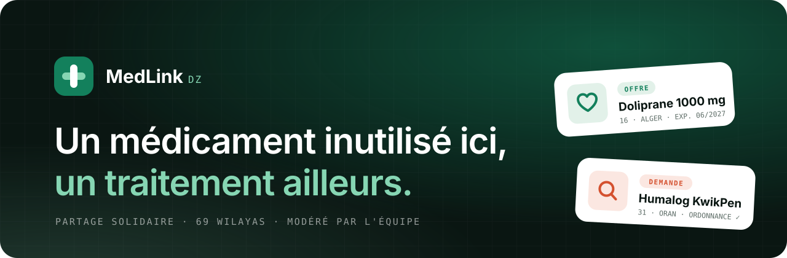
</a>

<br><br>

[](https://medlink-dz.vercel.app)
[](https://vercel.com)
[](https://render.com)
[](https://neon.tech)

[](https://tailwindcss.com)
[](https://vite.dev)
[](https://nodejs.org)
[](https://expressjs.com)
[](https://jwt.io)

<br>

**Offres · Demandes · Ordonnances privées · Modération · 69 wilayas**<br>
La plateforme solidaire qui relie les personnes qui ont des médicaments inutilisés<br>
à celles qui en ont besoin, partout en Algérie 🇩🇿

[**Voir le site**](https://medlink-dz.vercel.app) · [**Essayer la démo**](#-essayer-la-démo) · [**Documentation API**](docs/API.md) · [**Changelog**](CHANGELOG.md)

</div>

> [!IMPORTANT]
> **Projet de démonstration (portfolio).** La version en ligne tourne entièrement dans le navigateur avec des données fictives :
> aucun serveur, aucune vraie annonce, numéros de téléphone factices (`00 00 00 00 NN`). Un bandeau « Projet de démonstration »
> le rappelle sur chaque page et les moteurs de recherche sont tenus à l'écart (`noindex`). Le vrai backend (API + PostgreSQL) est
> dans [`backend/`](backend) ; son installation est décrite dans [docs/DEVELOPMENT.md](docs/DEVELOPMENT.md).

<br>

## ✦ Le projet

Chaque année, des boîtes de médicaments encore valides finissent à la poubelle pendant que d'autres patients
cherchent le même traitement d'une pharmacie à l'autre. **MedLink DZ** met ces deux personnes en relation :

- un membre **propose** un médicament qu'il n'utilise plus (avec sa date de péremption),
- un autre **recherche** un médicament précis (avec son ordonnance si elle est exigée),
- l'équipe **modère** chaque annonce avant publication,
- les membres se contactent ensuite directement, wilaya par wilaya.

> [!NOTE]
> MedLink DZ ne vend rien et n'intervient pas dans l'échange : c'est un outil de mise en relation gratuit,
> encadré par une modération humaine et des règles de sécurité sur les médicaments.

<br>

## ✦ Aperçu

<table>
<tr>
<td width="50%">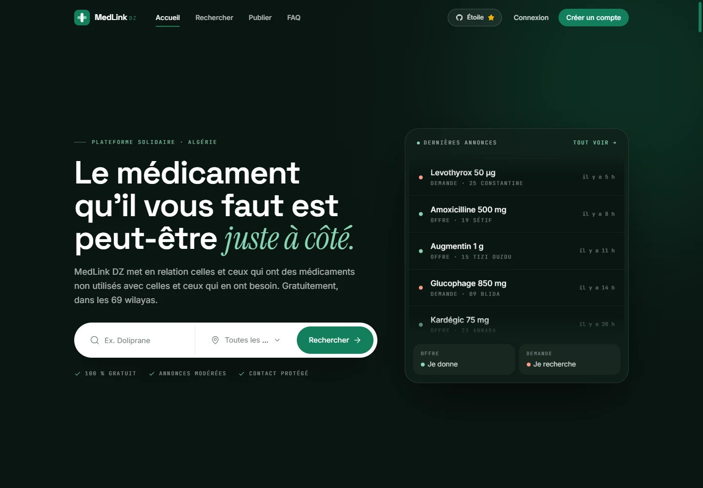</td>
<td width="50%">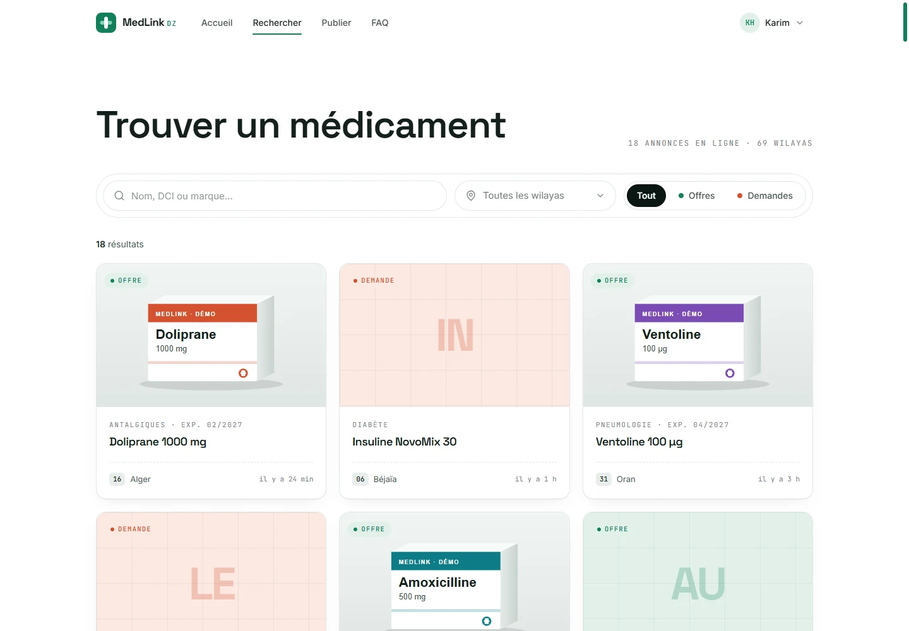</td>
</tr>
<tr>
<td align="center"><sub><b>Accueil</b> · visiteurs</sub></td>
<td align="center"><sub><b>Recherche</b> · filtres et cartes d'annonces</sub></td>
</tr>
<tr>
<td width="50%">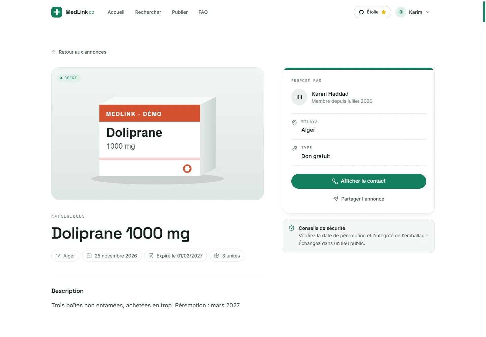</td>
<td width="50%"></td>
</tr>
<tr>
<td align="center"><sub><b>Annonce</b> · expiration et contact</sub></td>
<td align="center"><sub><b>Publication</b> · ordonnance obligatoire si exigée</sub></td>
</tr>
<tr>
<td width="50%">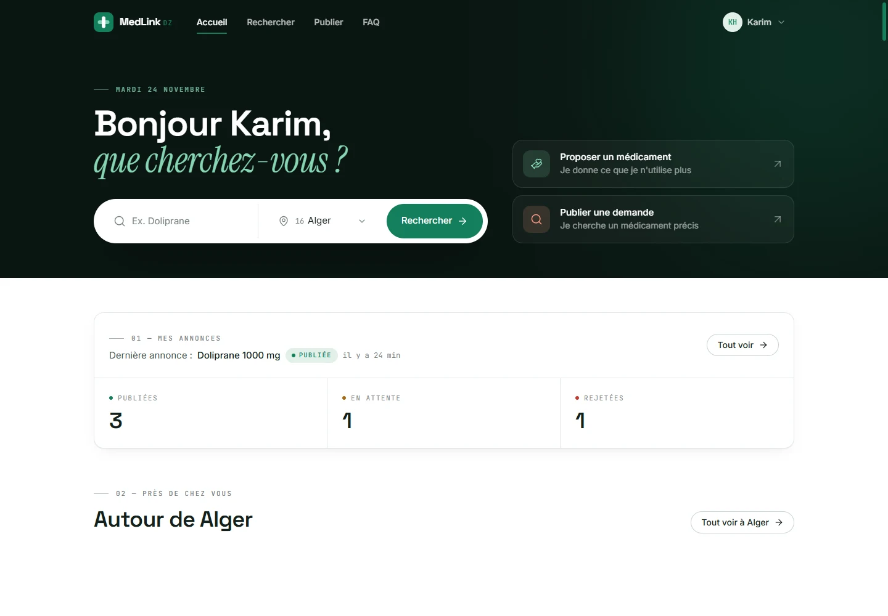</td>
<td width="50%">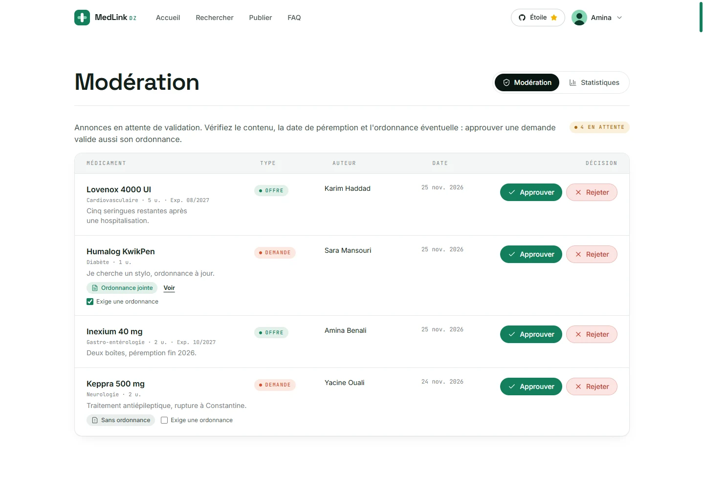</td>
</tr>
<tr>
<td align="center"><sub><b>Accueil membre</b> · suivi et annonces proches</sub></td>
<td align="center"><sub><b>Modération</b> · ordonnances et décisions</sub></td>
</tr>
</table>

<div align="center">
<br>
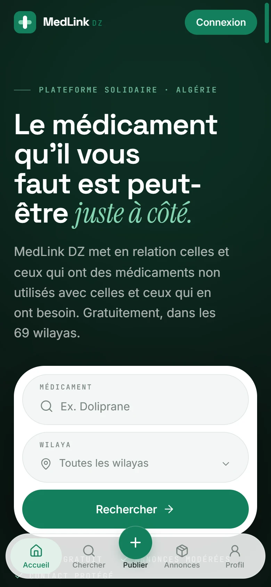
&nbsp;
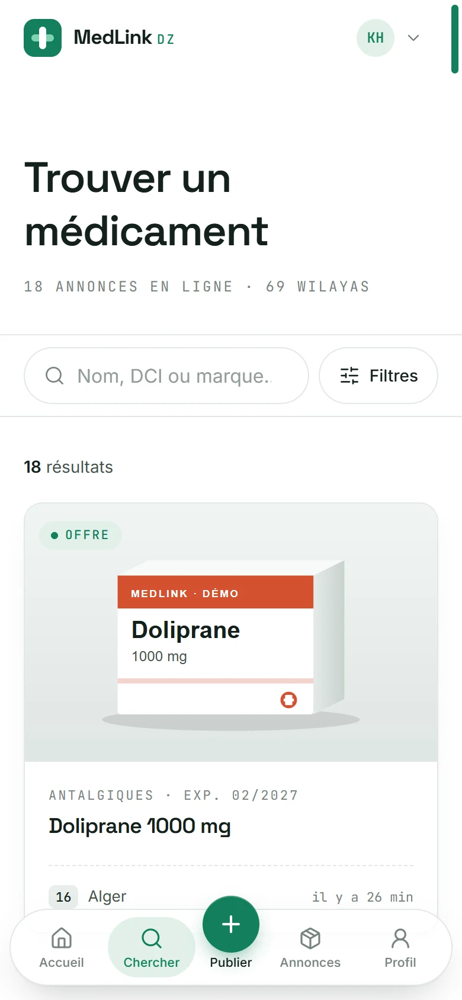
&nbsp;
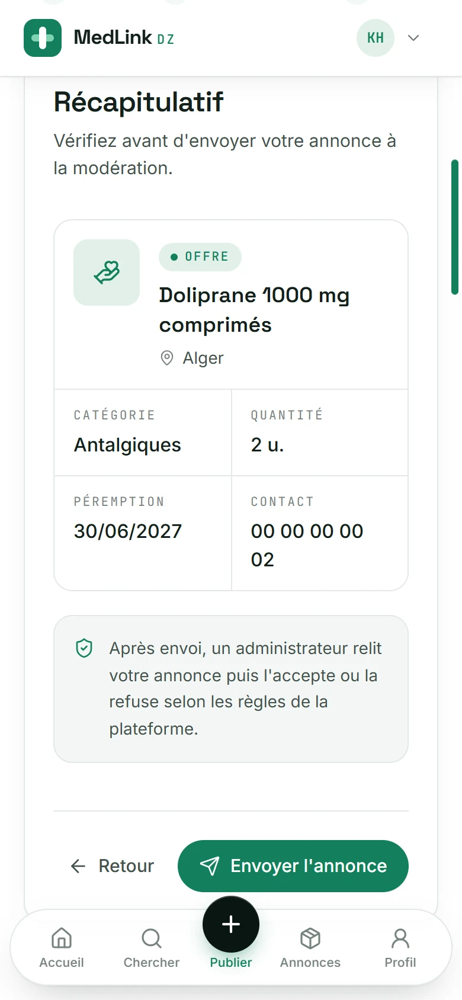
&nbsp;

<br>
<sub>Pensé d'abord pour le téléphone : barre de navigation fixe, récapitulatif et confirmation adaptés aux petits écrans.</sub>
<br><br>
<sub>Captures prises sur la <a href="#-essayer-la-démo">démo</a> : toutes les données sont fictives.</sub>
</div>

<br>

## ✦ Fonctionnalités

<table>
<tr>
<td width="50%" valign="top">

### 🔎 Recherche
Recherche par nom, type (offre / demande), catégorie et wilaya, avec les annonces proches de chez soi en priorité.
<sub>`/search` · `/annonce/:id`</sub>

### ✍️ Publication en 4 étapes
Type, médicament, localisation, récapitulatif. Date de péremption obligatoire pour les offres, médicaments périmés refusés.
<sub>`/publier`</sub>

### 📄 Ordonnances privées
Jointes aux demandes, obligatoires pour les médicaments signalés. Stockées hors du dossier public, visibles uniquement par leur auteur et les modérateurs.
<sub>`/api/ordonnances`</sub>

</td>
<td width="50%" valign="top">

### 🛡️ Console de modération
Validation ou rejet des annonces, consultation sécurisée des ordonnances, signalement des médicaments « sur ordonnance », gestion des comptes.
<sub>`/admin` · `/admin/stats`</sub>

### 👤 Espace membre
Accueil personnalisé, suivi du statut de chaque annonce (et de son ordonnance), profil et photo.
<sub>`/profil` · `/profil/annonces` · `/profil/modifier`</sub>

### 🔐 Comptes
Inscription en deux étapes, vérification par email, mot de passe oublié, sessions JWT.
<sub>`/register` · `/login` · `/verify-email`</sub>

</td>
</tr>
</table>

<br>

## ✦ Parcours d'une annonce

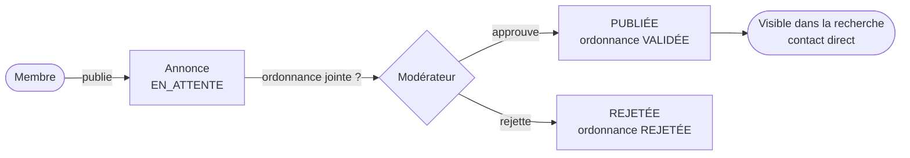

<br>

## ✦ Architecture

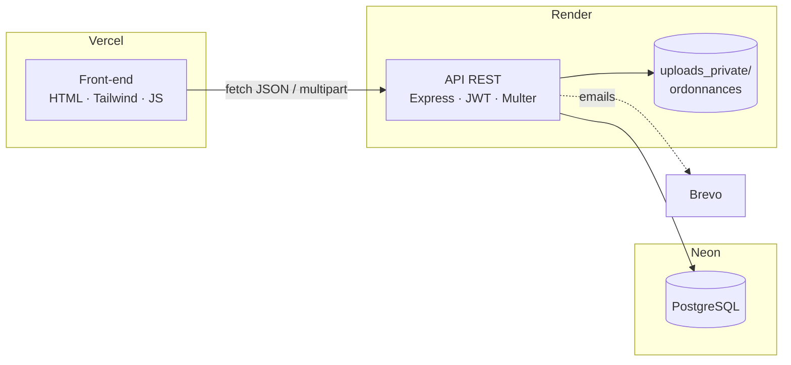

| Couche | Rôle |
|---|---|
| **Pages** | Un vrai fichier `.html` par page, URLs propres (`/login`, `/annonce/42`) en dev comme sur Vercel. |
| **Partials** | `<!-- @include header -->` est remplacé au build par `src/partials/header.html` (plugin dans `vite.config.js`). |
| **Styles** | Tailwind CSS v4, tous les tokens dans le bloc `@theme` de `src/styles/main.css`, composants dans `@layer components`. |
| **Scripts** | Modules ES sans framework : `core/` (API, auth, layout), `components/`, un script par page dans `pages/`. |
| **API** | Express en couches `routes → controllers → services`, PostgreSQL via `pg`, migrations appliquées automatiquement au démarrage. |
| **Démo** | Une API fictive tourne dans le navigateur (`frontend/mock/`, mêmes règles que la vraie API), avec bandeau « démo » et `noindex`. Le build normal du site n'en contient rien. |

<br>

## ✦ Sécurité & confidentialité

- **Ordonnances** : enregistrées dans `backend/uploads_private/` (jamais servi en statique ni commité), noms de fichiers aléatoires, lecture réservée à l'auteur et aux admins (`404` pour les autres), `Cache-Control: private, no-store`.
- **Données personnelles** : le hash du mot de passe n'est jamais renvoyé ; le téléphone d'un membre n'est visible que par les utilisateurs connectés ; une annonce non publiée n'est visible que par son auteur et les admins.
- **Règles métier vérifiées côté serveur** : date de péremption future pour les offres, catégorie valide, ordonnance appartenant au membre et non réutilisée, ordonnance obligatoire pour les médicaments signalés.
- **Modération en cascade** : publier une demande valide son ordonnance, la rejeter la rejette aussi (transaction SQL).

<br>

## ✦ Essayer la démo

**[→ Ouvrir medlink-dz.vercel.app](https://medlink-dz.vercel.app)**, rien à installer : tout fonctionne dans le navigateur.

Sur la page de connexion, utilisez l'un de ces comptes de démonstration :

| Compte | Email | Mot de passe | À essayer |
|---|---|---|---|
| **Membre** | `membre@medlink.test` | `demo1234` | publier une offre ou une demande (avec ordonnance), suivre son statut dans « Mes annonces » |
| **Administrateur** | `admin@medlink.test` | `demo1234` | modérer les annonces, ouvrir une ordonnance, marquer un médicament « sur ordonnance » |

<details>
<summary><b>Un parcours de 2 minutes</b></summary>

<br>

1. Connectez-vous en **membre**, puis *Publier* → **Je recherche** → « Ritaline 10 mg » : l'ordonnance devient obligatoire.
2. Joignez n'importe quelle image ou PDF (il n'est jamais conservé), puis envoyez : l'annonce passe « En attente ».
3. Ouvrez le bouton **Démo** (en bas) → *Administrateur* → *Modération* : consultez l'ordonnance, puis **Approuver**.
4. Revenez en membre : l'annonce est publiée et son ordonnance « validée ».

Le bouton **Démo** permet de changer de vue (Visiteur / Membre / Admin) et de réinitialiser les données à tout moment.

</details>

> [!NOTE]
> Tout se passe dans votre navigateur : ce que vous publiez reste sur votre appareil, ne part sur aucun serveur et disparaît à la réinitialisation (ou au bout de 24 h).

<br>

## ✦ Structure du projet

```txt
MedLinkDZ/
├── .github/assets/          banner et captures du README
├── CHANGELOG.md             historique des versions
├── docs/
│   ├── API.md               référence de tous les endpoints
│   ├── DEVELOPMENT.md       lancer le projet en local (pour contribuer)
│   └── class-diagram.pdf    diagramme de classes
│
├── backend/                 API REST — Node.js · Express
│   ├── server.js            point d'entrée (démarrage + migrations)
│   ├── database/schema.sql  schéma PostgreSQL
│   ├── src/
│   │   ├── app.js           configuration Express
│   │   ├── config/          connexion PostgreSQL, migrations et données de base
│   │   ├── routes/          auth · annonces · catalog · ordonnances · admin
│   │   ├── controllers/     validation des requêtes, règles métier
│   │   ├── services/        requêtes SQL
│   │   ├── middlewares/     JWT, rôles, uploads (public / privé), erreurs
│   │   └── utils/           tokens, mots de passe, emails
│   ├── uploads/             images publiques (ignorées par git)
│   └── .env.example
│
├── frontend/                site — HTML · Tailwind CSS v4 · JS (Vite)
│   ├── index.html …         une page par fichier (search, annonce, publier, login…)
│   ├── profil/  admin/      pages de l'espace membre et de la console admin
│   ├── src/
│   │   ├── styles/main.css  design system (tokens, composants, animations)
│   │   ├── partials/        header, footer, head… inclus au build
│   │   └── js/
│   │       ├── core/        client API, auth, layout, icônes, toasts
│   │       ├── components/  carte d'annonce, sélecteur de wilaya, dialogue
│   │       ├── data/        les 69 wilayas
│   │       └── pages/       un script par page
│   ├── mock/                API fictive qui tourne dans le navigateur (démo)
│   ├── public/              favicon, photo de connexion, cartes d'aperçu de liens (og/)
│   ├── scripts/             génération des cartes d'aperçu (Chrome headless)
│   ├── vite.config.js       pages, partials, URLs propres, mode démo
│   └── vercel.json
│
└── package.json             scripts du monorepo
```

<br>

## ✦ Design system

| Couleur | Token | Hex | Usage |
|---|---|---|---|
| [](#) | `ink` | `#0A1612` | hero, footer, textes forts |
| [](#) | `brand` | `#13805C` | actions principales, **Offre** |
| [](#) | `signal` | `#D4512F` | **Demande** |
| [](#) | `mint` | `#86D6B3` | accents sur fond sombre |
| [](#) | `paper` | `#F4F7F6` | sections alternées, encarts |
| [](#) | `line` | `#E3E8E6` | bordures fines |

**Typographie** : Space Grotesk (titres) · Inter (texte) · JetBrains Mono (étiquettes, codes, dates).
**Composants** : `btn`, `field-control`, `card`, `tag`, `chip`, `notice`, `segmented`, `toast`… définis une seule fois dans `main.css`.

<br>

## ✦ Déploiement

| Service | Hébergement | Dossier racine | Commande |
|---|---|---|---|
| Site (version démo, en ligne) | Vercel | `frontend` | `npm run build:demo` → `dist/` (réglé dans `vercel.json`) |
| Site (connecté à l'API) | Vercel | `frontend` | `npm run build` + `VITE_API_URL` |
| API | Render | `backend` | `npm start` |
| Base de données | Neon | — | `DATABASE_URL` dans Render |

La version en ligne n'a pas besoin de l'API : pour la brancher au vrai backend, remplacez `buildCommand` par `npm run build` dans `frontend/vercel.json`.

<br>

<div align="center">

**MedLink DZ** · projet full-stack de partage solidaire de médicaments pour l'Algérie

<sub>Les informations publiées sur la plateforme ne remplacent pas l'avis d'un médecin ou d'un pharmacien.</sub>

</div>
